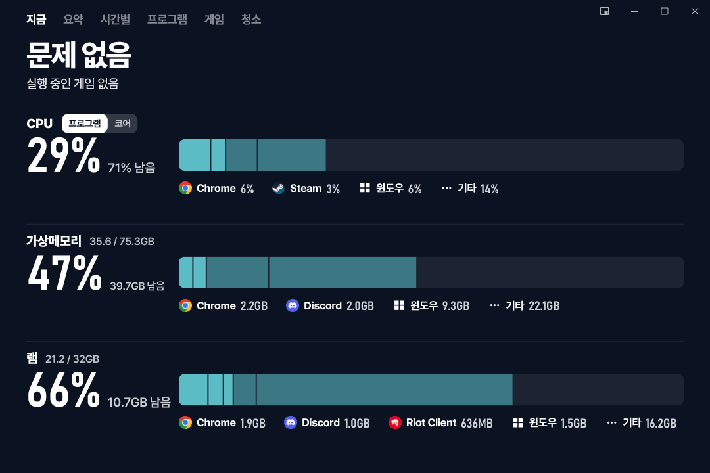
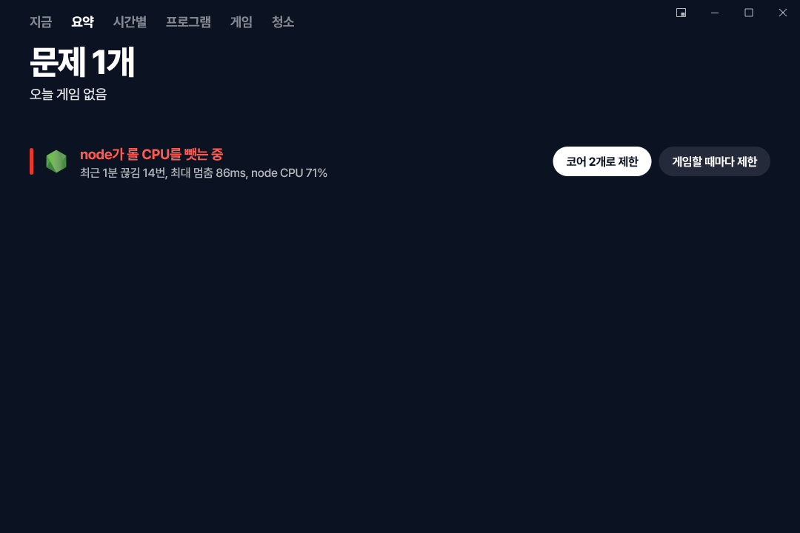
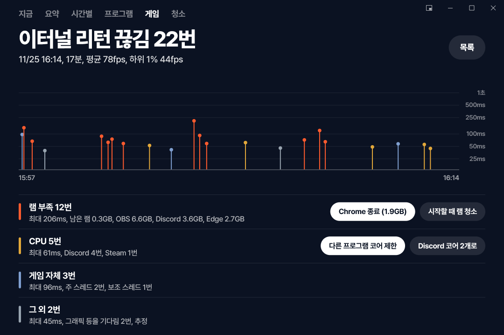

# 렉 감시 (LagWatch)

게임이 끊길 때 원인을 찾는 가벼운 윈도우 트레이 프로그램. CPU·램·가상메모리를 누가 쓰는지 보고 바로 정리한다.

[English](README.md)



| 요약 | 판 하나 |
|---|---|
|  |  |

## 하는 일

| 탭 | 내용 |
|---|---|
| 지금 | CPU·가상메모리·램 사용률과 남은 양, 많이 쓰는 순서. CPU는 코어별로도 본다 |
| 요약 | 문제와 손볼 것, 바로 누를 수 있는 조치, 해 둔 것 |
| 시간별 | 3시간·12시간·하루 |
| 프로그램 | 전체 목록, 검색, 정렬, 3시간 변화. 재시작·종료·코어 제한·우선순위 |
| 게임 | 이터널 리턴·롤 설정, 판마다 프레임과 끊김, 언제 왜 끊겼는지 |
| 청소 | 램, 오래된 임시 파일 |

- 사용률이 70%를 넘으면 주황, 90%를 넘으면 빨강.
- 끊긴 까닭: 램 부족, 디스크, CPU, 드라이버, 게임 자체, 그 외. 게임의 바쁜 두 스레드가 그 프레임 동안 돌았는지, CPU 차례를 기다렸는지(누구 때문에), 메모리를 디스크에서 기다렸는지로 나눈다. 재지 못한 것은 짐작하고 `추정`이라 적는다.
- 가상메모리가 계속 느는 프로그램을 찾아 게임이 끝난 뒤 재시작하게 예약할 수 있다.
- 트레이 아이콘에 마우스를 올리면 간단히 보기, 누르면 작은 창.

## 필요한 것

윈도우 10 64비트(.NET Framework 4.8은 윈도우에 들어 있다). 10 22H2에서 시험했고 11에서는 시험하지 않았다.

| | 일반 실행 | 관리자 실행 |
|---|---|---|
| CPU·램·가상메모리, 시간별 | O | O |
| 프레임·끊김 | Performance Log Users에 있으면 O | O |
| 끊긴 까닭, 코어별 프로그램, 드라이버 | X | O |
| 내 프로그램 종료·코어·우선순위 | O | O |
| 다른 계정(SYSTEM)의 프로세스 제한 | X | O |
| 게임 우선순위 등록 | X | O |
| 램 청소 | 내 프로그램만, 캐시 제외 | O |
| 윈도우 임시 파일·업데이트 파일 | X | O |

윈도우 표시 언어가 한국어면 한국어, 아니면 영어로 켜진다. 트레이 메뉴에서 바꿀 수 있다.

## 안전

- 게임과 안티치트 프로세스는 열지 않는다. 프레임과 스레드는 윈도우 기록(ETW)에서 읽는다.
- 게임 CPU 우선순위는 윈도우 실행 옵션(`Image File Execution Options`)에 등록하고 다음 실행부터 적용된다. `되돌리기`로 처음 값이 된다.
- DB, 서버, 게임 클라이언트, 윈도우 구성 요소는 종료하거나 제한하지 않는다.
- 코어·우선순위 제한은 게임이 끝나거나, 해제하거나, 렉 감시를 끝내면 원래 값으로 돌아간다. 비정상 종료돼도 다음 실행 때 되돌린다.
- 임시 파일은 정해진 폴더 안에서 오래된 것만 지운다. 정션·링크는 따라가지 않고, 최근 파일이 있는 폴더, `.git`·`node_modules`, 사용 중인 파일은 남긴다. 휴지통을 거치지 않는다.
- 네트워크를 쓰지 않는다. 기록은 `%LOCALAPPDATA%\LagWatch`에만 35일 보관한다.
- Riot Games·님블뉴런과 관계없고, 두 회사의 확인을 받은 프로그램이 아니다. 쓰는 것은 각자 책임이다.

## 사용량

8코어 16스레드, 램 32GB에서 잰 1.6. CPU는 코어 하나 기준.

| | CPU | 커밋 |
|---|---|---|
| 트레이만 | 0.05~0.16% | 13MB(창을 한 번 연 뒤에는 22MB) |
| 큰 창 | 0.5% | 23MB |
| 코어 보기 | 2% | |
| 게임 중(끊긴 까닭까지) | 1.3~2.2% | 18MB |

게임 중 값은 가짜 게임 프로세스로 쟀다. 실제 게임에서는 달라질 수 있다.

## 빌드

.NET SDK(10 이상)와 PowerShell 7이 필요하다. 결과는 `dist\LagWatch.exe`.

```
pwsh -File build.ps1
build\Tests.exe                  # 시험. 관리자로 켜면 실제 윈도우 기록도 시험한다
pwsh -File desk.ps1              # 보이지 않는 데스크톱에서 실제 창 시험
build\LagWatchCli.exe --bench 30 # 자신의 CPU·메모리 측정
```

앱은 mscorlib만 참조한다. 화면은 직접 그리고 글자 모양만 DirectWrite에서 얻는다.

다른 게임은 `%LOCALAPPDATA%\LagWatch\settings.txt`에 `game=실행파일이름`(.exe 빼고)을 적으면 게임으로 본다.

## 라이선스

코드는 [MIT](LICENSE). 글꼴은 SIL Open Font License 1.1이고 쓰는 글자만 남겨 이름을 바꿔 넣었다: [Pretendard](res/OFL-Pretendard.txt)(LW Sans), [Wanted Sans](res/OFL-WantedSans.txt)(LW Wide).
