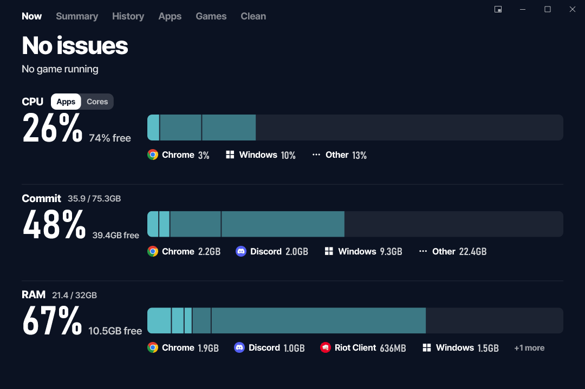
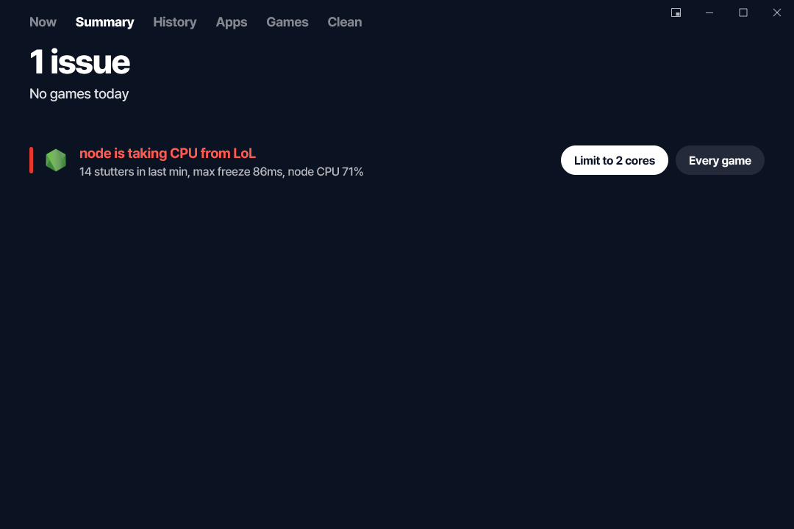
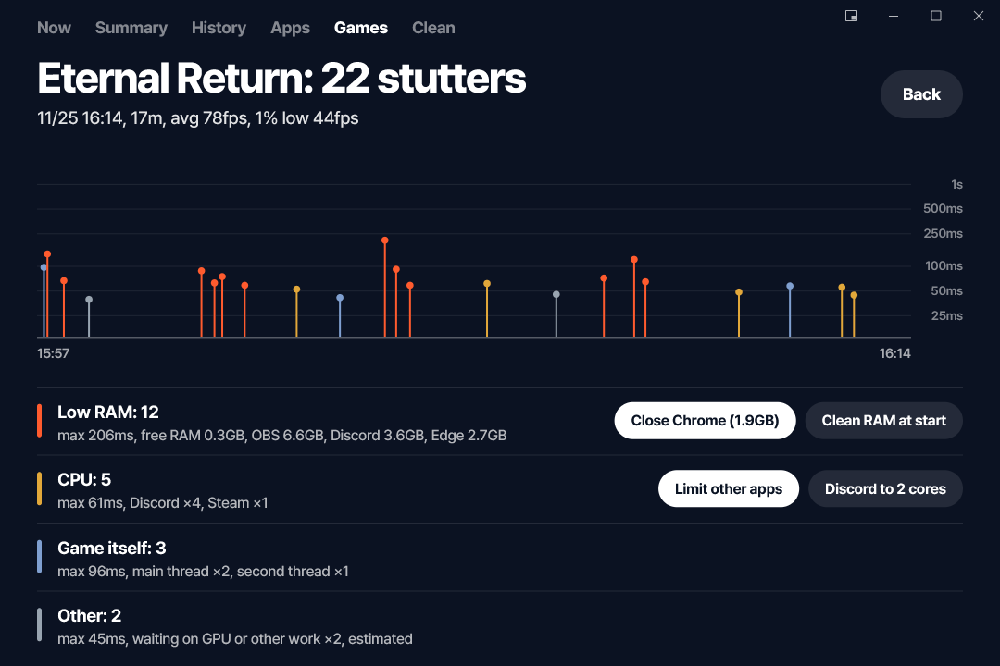
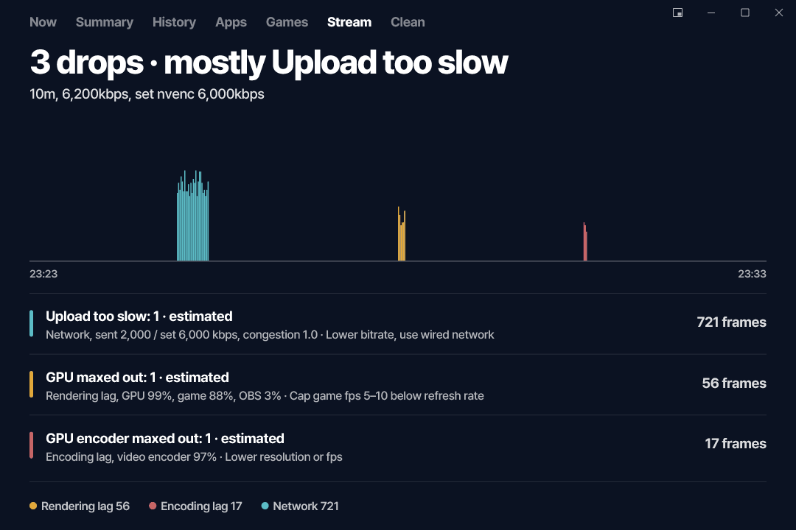

# LagWatch

A lightweight Windows tray app that shows what is using your CPU, RAM and committed memory, and finds out why your game stutters.

[한국어](README.ko.md)



| Summary | One match |
|---|---|
|  |  |

## What it does

| Tab | Contents |
|---|---|
| Now | CPU, commit and RAM: how much is used, how much is free, and which apps use the most. CPU can be shown per core |
| Summary | Issues and things to check, each with a button to fix it, and the changes you made |
| History | Last 3, 12 or 24 hours |
| Apps | Everything running, with search, sorting and the 3-hour change. Restart, close, limit cores, lower priority |
| Games | Settings for Eternal Return and League of Legends, frame rate and stutters per match, and when and why each stutter happened |
| Stream | While OBS streams or records: dropped frames and PC state every second, the likely cause and what to do when frames drop, and a summary when the stream ends |
| Clean | RAM and old temp files |

- Usage turns orange above 70% and red above 90%.
- Stutter causes: low RAM, disk, CPU, driver, the game itself, other. For each stutter LagWatch checks whether the game's two busiest threads were running, waiting for the CPU (and which app had it), or waiting for memory to be read from disk during that frame. Stutters it couldn't measure are guessed and marked `estimated`.
- Finds apps whose commit keeps growing and can restart them after the game.
- Hover over the tray icon for a quick look, click it for the compact window.
- The Stream tab needs the OBS WebSocket server turned on (OBS → Tools → WebSocket Server Settings). The password is read from the OBS settings file.
- Stream drop causes: GPU maxed out, heavy OBS scene, CPU encoder overloaded, GPU encoder maxed out, upload too slow, another app took the CPU, low RAM. Dropped frame counts come from OBS; causes are `estimated`.



## Requirements

64-bit Windows 10 (.NET Framework 4.8 comes with Windows). Tested on 10 22H2. Not tested on Windows 11.

| | Standard user | Administrator |
|---|---|---|
| CPU, RAM, commit, history | Yes | Yes |
| Frame rate, stutters | If in Performance Log Users | Yes |
| Stutter causes, apps per core, drivers | No | Yes |
| Close or limit your own apps | Yes | Yes |
| Limit processes of other accounts (SYSTEM) | No | Yes |
| Set game priority | No | Yes |
| Clean RAM | Your apps only, no cache | Yes |
| Windows temp and update files | No | Yes |

The app starts in Korean if Windows is in Korean, otherwise in English. You can switch from the tray menu.

## Safety

- Game and anti-cheat processes are never opened. Frames and thread activity are read from Windows event tracing (ETW).
- Game CPU priority is registered in Windows' `Image File Execution Options` and applies from the next launch. `Revert` puts the original value back.
- Databases, servers, game clients and Windows components are never closed or limited.
- Core and priority limits are undone when the game ends, when you remove them, or when LagWatch exits. If LagWatch crashes, they are undone the next time it starts.
- Temp cleaning only removes old files inside known folders. It doesn't follow junctions or links, and it keeps folders with recent files, `.git` and `node_modules`, and files in use. Deleted files don't go to the Recycle Bin.
- The only network connection is to the OBS WebSocket on this PC (127.0.0.1). OBS settings are read, never changed. Records stay in `%LOCALAPPDATA%\LagWatch` for 35 days.
- Not affiliated with, or reviewed by, Riot Games or Nimble Neuron. Use it at your own risk.

## Resource use

Version 1.6 on 8 cores / 16 threads and 32 GB of RAM. CPU is relative to one core.

| | CPU | Commit |
|---|---|---|
| Tray only | 0.05–0.16% | 13 MB (22 MB once the window has been opened) |
| Main window | 0.5% | 23 MB |
| Per-core view | 2% | |
| In game, including stutter causes | 1.3–2.2% | 18 MB |
| Recording an OBS stream (no game) | 0.22% (1.7, 30 min) | 28 MB |

The in-game row was measured with a dummy game process. Real games may differ.

## Build

You need the .NET SDK (10 or later) and PowerShell 7. The result is `dist\LagWatch.exe`.

```
pwsh -File build.ps1
build\Tests.exe                  # tests; run as administrator to include live ETW tests
pwsh -File desk.ps1              # drives the real windows on a hidden desktop
build\LagWatchCli.exe --bench 30 # measures its own CPU and memory
```

The app references only mscorlib. It draws its own UI and uses DirectWrite only for glyph shapes. Source comments are in Korean.

To treat another program as a game, add `game=ExeName` (without .exe) to `%LOCALAPPDATA%\LagWatch\settings.txt`.

## License

Code: [MIT](LICENSE). Fonts: SIL Open Font License 1.1, subset and renamed: [Pretendard](res/OFL-Pretendard.txt) (LW Sans) and [Wanted Sans](res/OFL-WantedSans.txt) (LW Wide).
